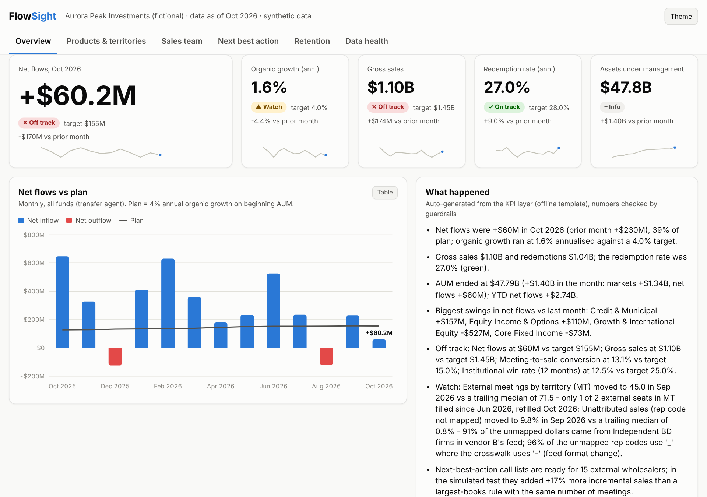
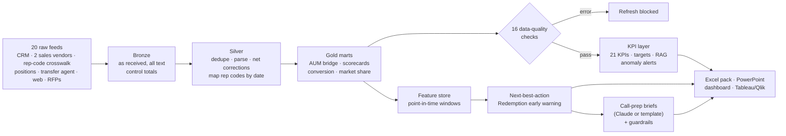
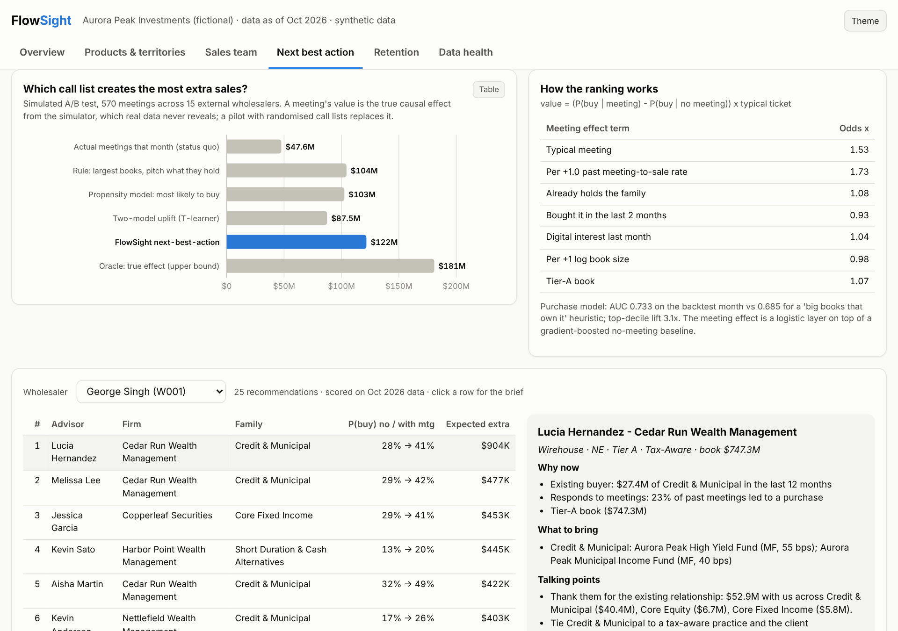
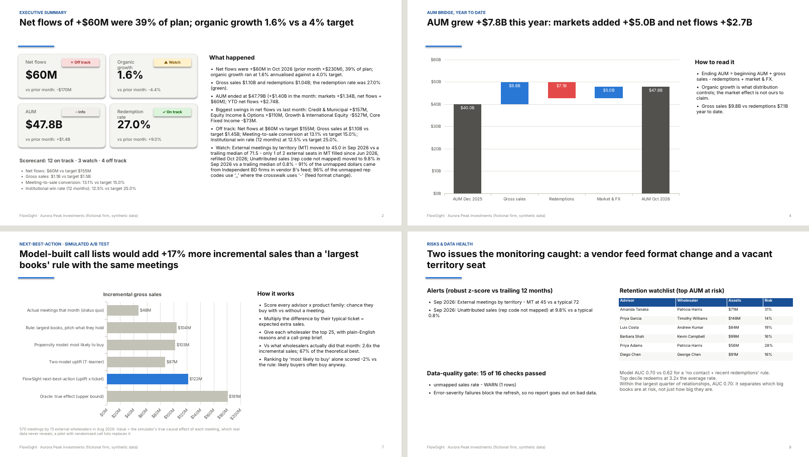

# FlowSight - distribution intelligence for an asset manager

[](https://github.com/mukesh132001/flowsight/actions/workflows/ci.yml)
&nbsp;**[Live dashboard](https://mukesh132001.github.io/flowsight/)** · [Findings memo](docs/findings-memo.md) ·
[Excel KPI pack](samples/FlowSight_KPI_Pack_2026-10.xlsx) · [PowerPoint review](samples/FlowSight_Distribution_Review_2026-10.pptx)

Sales and distribution analytics for a fund manager that sells through financial advisors: a
**Python + PySpark + SQL** pipeline, a **KPI framework** with monitoring, **next-best-action** and
**redemption early-warning** models, **GenAI call-prep briefs** with compliance guardrails, and the outputs a
distribution team actually uses - an **Excel KPI pack, a PowerPoint review deck, a web dashboard and
Tableau / Qlik extracts**.

Built to mirror how asset-management distribution, BI and sales-enablement teams work: SQL-first models on
Spark/Databricks, KPI definitions with owners and targets, ML judged by business outcomes, Agile delivery
with a full BA pack.

> **Aurora Peak Investments is fictional and every number is synthetic.** Firm, fund, advisor and client
> names are random combinations. A simulator generates the raw feeds *with* the problems real feeds have.

**Start here: [findings memo](docs/findings-memo.md)** - three recommendations. The headline: model-built
call lists created **+17% more incremental sales than a "largest books first" rule, and 2.6x what wholesalers
actually did**, with the same 570 meetings (simulated A/B test). The KPI monitoring also caught a vendor
feed format change that left **9.8% of a month's sales unattributed**.



## What it does



The same SQL runs on **SQLite** (laptop, tests, CI) and **Spark** (local or Databricks); a CI job builds
every table on both engines and compares them.

## Results (October 2026 run, synthetic data)

| Area | Result |
| --- | --- |
| Pipeline | 655K raw rows -> 30 SQL models (1.8M rows) in about 2 minutes; 16 data-quality checks, 13 of which block the refresh; AUM bridge ties to the transfer agent to the cent |
| KPIs | 21 headline KPIs with owner, target and status rule; anomaly alerts caught the Sep-2026 vendor format change (z = 17) and a 4-month territory vacancy |
| Next-best-action | Purchase model AUC **0.733** out of time (vs 0.685 for a book-size heuristic), top-decile lift 3.1x |
| Simulated A/B test | **$121.7M** incremental gross sales from 570 meetings vs **$104.4M** for the best simple rule (+17%) and **$47.6M** for actual coverage; a plain "likely to buy" list scored -2% vs the rule |
| Redemption early warning | AUC **0.700** vs 0.618 for a rule; top decile redeems at 3.2x the average rate; watchlist of 293 advisors with $493M AUM at risk |
| GenAI | 32 call-prep briefs and the monthly commentary, 100% passing compliance + number-grounding guardrails; runs offline without an API key |
| Quality | 39 tests (data quality, leakage, guardrails, reports) on every push; Spark parity job in CI |



## Tech stack

| Area | Tools |
| --- | --- |
| Data engineering | Python, **PySpark** (explicit schemas, corrupt-record quarantine, Parquet/Delta), **SQL** (30 portable models, window functions), SQLite, Databricks notebook |
| Analytics & KPIs | KPI semantic layer in YAML, robust anomaly detection, driver analysis |
| ML | scikit-learn gradient boosting + logistic benchmark, uplift via offset-logistic meeting-effect layer, out-of-time backtests, policy simulation |
| GenAI | Claude (Anthropic Messages API) with grounded prompts, compliance guardrails and number grounding; offline templates |
| BI & storytelling | Excel (xlsxwriter: live formulas, sparklines, native charts), PowerPoint (python-pptx: native charts, takeaway titles), HTML dashboard (no external scripts), Tableau / Qlik Sense extracts + load script |
| Delivery | pytest, GitHub Actions (tests + Spark parity + Pages), GitLab CI mirror, backlog as GitHub issues |

## Repository layout

```
config/            settings.yaml, kpis.yaml (KPI semantic layer), glossary.yaml (column docs)
models/            SQL models: silver/ gold/ features/ checks/  (one file = one table or one check)
src/flowsight/
  simulate/        synthetic world + messy raw feeds + hidden ground truth
  pipeline/        SQLite and PySpark engines, DAG runner, SQL lint, cross-engine parity
  kpi/             KPI computation, targets / RAG, anomaly detection, driver analysis
  ml/              features, next-best-action, redemption early warning, policy simulation, reasons
  ai/              LLM client, call-prep briefs, commentary, guardrails
  reporting/       Excel pack, PowerPoint deck, dashboard, BI extracts, docs generator
databricks/        notebook: run the Spark engine and publish Delta tables
docs/              BA pack: BRD, KPI framework, backlog & sprints, UAT, stakeholders, model card, lineage
samples/           committed copies of the Excel pack, deck, commentary and briefs
site/              the dashboard, published by GitHub Pages
tests/             pytest suite (builds the whole project on the small scale)
```

## Quick start

```powershell
python -m venv .venv
.venv\Scripts\activate                  # Windows  (source .venv/bin/activate on macOS/Linux)
pip install -r requirements.txt
$env:PYTHONPATH = "src"                 # Windows PowerShell (export PYTHONPATH=src on macOS/Linux)

python -m flowsight run                 # generate data and build everything (about 2 minutes)
start outputs\dashboard\index.html      # open the dashboard
pytest                                  # 39 tests, small scale
```

Individual steps: `generate`, `pipeline`, `kpis`, `ml`, `ai`, `reports`, `docs`. Use `--scale small` for a
build in under a minute. Outputs land in `outputs/` (git-ignored); copies for GitHub readers are in `samples/`.

**Publish your own copy:** `powershell -ExecutionPolicy Bypass -File scripts\publish-github.ps1` creates the
public repo, pushes, turns on GitHub Pages for the dashboard and opens the sprint backlog as issues (it installs
git and the GitHub CLI with winget if they are missing, and is safe to re-run).

**Claude for the briefs (optional):** copy `.env.example` to `.env` or set `$env:ANTHROPIC_API_KEY`. Every
draft still goes through the guardrails and falls back to the template if it fails.

### Run on Spark

```powershell
pip install -r requirements-spark.txt   # PySpark 3.5 (needs Java 17)
python -m flowsight run --engine spark  # same SQL, Spark engine, Parquet output in data/warehouse
python -m flowsight parity --scale small  # build on SQLite and Spark and compare every table
```

On Databricks, import `databricks/flowsight_pipeline.py`: it generates the feeds into a Unity Catalog
volume, runs the Spark engine and publishes the gold and feature tables as Delta.

## How it works

**Data (simulated).** 3,000 advisors at 118 firms in 8 territories, 20 funds in 7 families, 24 wholesalers,
34 months. Advisors have hidden affinities, responsiveness and loyalty; interest shows up first in digital
engagement, then in purchases; meetings have a *heterogeneous* causal effect; poor relative performance,
neglect and firm moves drive redemptions. The feeds carry realistic problems: duplicate CRM syncs, 14
spellings of 4 activity types, two date formats, cancel-and-rebill corrections, `$1,234.50` text amounts,
firm names instead of IDs, split rep codes missing from the crosswalk, a vendor format change, late
reporting. The hidden truth is saved separately and used only to evaluate call-list policies.

**Pipeline.** Bronze loads every column as text (both engines), so the SQL does all parsing and the engines
agree. Silver de-duplicates with window functions, nets corrections by trade reference, and maps rep codes
to advisors **for the trade month**. Gold builds the AUM bridge, scorecards and conversion. A lint test keeps
the SQL inside the subset SQLite and Spark share (no date functions, explicit casts, no bare decimals).

**KPIs.** [`config/kpis.yaml`](config/kpis.yaml) defines each KPI once - definition, formula, owner, SQL,
target and status rule - and the [KPI dictionary](docs/kpi-dictionary.md) is generated from it. Alerts use a
robust z-score against each KPI's own trailing year, with root-cause hints (vendor and rep-code pattern for
attribution gaps, vacant seats for coverage drops). See the [KPI framework](docs/kpi-framework.md).

**Models.** Next-best-action ranks advisor x product family by *(P(buy | meeting) - P(buy | no meeting)) x
typical ticket*: a boosted-tree no-meeting baseline plus a small logistic layer for the meeting effect, whose
coefficients are readable. A redemption early-warning model ranks advisors by AUM at risk. Leakage is tested
by parsing the feature SQL. Details and limitations: [model card](docs/model-card.md).

**GenAI.** Facts for each brief are gathered with SQL; Claude (or a template) writes the brief; guardrails
reject promissory language and any dollar or percentage figure not in the facts, then fall back to the
template. The monthly commentary works the same way.

## The BA / Agile pack

| Document | What it shows |
| --- | --- |
| [Business requirements](docs/business-requirements.md) | Objectives, scope, 13 requirements with MoSCoW priority and traceability |
| [Backlog & sprint log](docs/backlog-and-sprints.md) | Personas, epics, user stories with Gherkin acceptance criteria, 4 sprints and how requirements changed |
| [UAT test cases](docs/uat-test-cases.md) | Each requirement -> business test -> automated test |
| [Stakeholder plan](docs/stakeholder-plan.md) | Influence/interest map, RACI, cadence, what each audience needs |
| [KPI framework](docs/kpi-framework.md) · [KPI dictionary](docs/kpi-dictionary.md) | Metric tree, design rules, monitoring; generated definitions |
| [Data dictionary](docs/data-dictionary.md) · [lineage](docs/lineage.md) | Every column of every model (a test fails if one is undocumented) |
| [Model card](docs/model-card.md) | Both models: data, validation, decision quality, limitations, monitoring |
| [Tableau / Qlik build guide](docs/tableau-build-guide.md) | Building the self-service workbook from the extracts |
| [Notes to know](docs/notes-to-know.md) | Concepts behind each milestone and interview prep |



## Roadmap

- [x] **Sprint 1 - Trusted data:** bronze load with control totals, vendor conformance, CRM cleanup
- [x] **Sprint 2 - Shared KPIs:** semantic layer, AUM bridge, scorecards, data-quality gate
- [x] **Sprint 3 - Act on it:** next-best-action, policy simulation, redemption early warning, alerts
- [x] **Sprint 4 - Tell the story:** briefs + guardrails, Excel, PowerPoint, dashboard, Spark parity, Databricks
- [ ] Publish the Tableau Public workbook from the extracts
- [ ] Pilot design: randomised call lists by territory, 6 weeks

## Related

* [card-risk-analytics](https://github.com/mukesh132001/card-risk-analytics) - card spend and risk analytics:
  dbt star schema, reconciliation, fraud/default models and a Claude colleague assistant.
* [card-banking-platform](https://github.com/mukesh132001/card-banking-platform) - the transaction platform
  behind that data.
