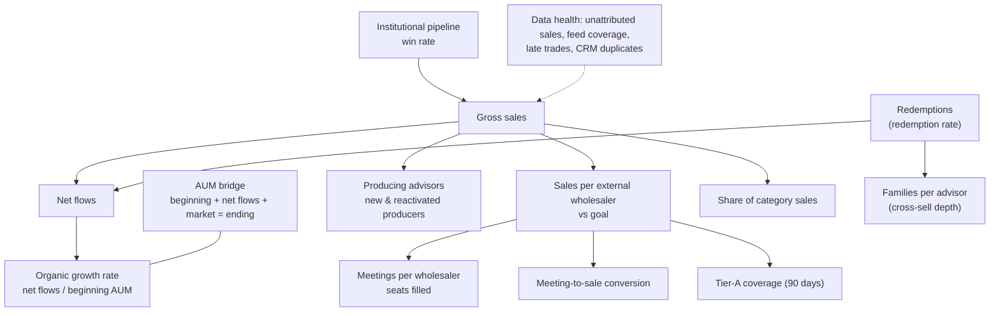

# KPI framework

How FlowSight measures distribution performance, and why it measures it that way. The definitions themselves
live in one place - [`config/kpis.yaml`](../config/kpis.yaml) - and the [KPI dictionary](kpi-dictionary.md) is
generated from it.

## Metric tree

Organic growth is the north star: it is the growth distribution earned, separated from what markets gave.

## Tiers

| Tier | Purpose | Examples | Who looks |
| --- | --- | --- | --- |
| North star | Are we growing? | Organic growth rate | Executive committee |
| Driver | What moved it? | Net flows, gross sales, redemption rate, AUM, fee run rate, market share | Head of Distribution, product |
| Input | What can sales leaders change this month? | Meetings, seats filled, conversion, tier-A coverage, producers, cross-sell, pipeline | Regional directors, wholesalers |
| Health | Can we trust the numbers? | Unattributed sales, feed coverage, late trades, CRM duplicates | Sales operations, data governance |

Leading vs lagging: meetings, coverage and digital engagement lead; gross sales lag them by one to three
months; organic growth lags everything. The monthly review reads the tree top-down and acts bottom-up.

## Design rules

1. **One definition, one owner.** Each KPI has a business definition, a formula, an owner and SQL in
   `kpis.yaml`. Reports never re-implement a KPI; they read `kpi_results`.
2. **Book of record first.** Flow KPIs use transfer-agent totals; intermediary feeds are used for attribution
   (who sold it), and the gap between the two is itself a KPI (feed coverage).
3. **Rates over levels for comparisons.** Organic growth and redemption rates are annualised so months and
   firms of different sizes compare.
4. **Targets match the KPI's nature.** Fixed (organic growth 4%), plan-based (net flows = 4% of beginning
   AUM), prior-year +x% (gross sales, producers), or baseline +x% (market share, conversion).
5. **Status is a rule, not an opinion.** GREEN / AMBER / RED come from the rule in the YAML (ratio to target
   or absolute thresholds) and always print with an icon and a word, never colour alone.
6. **Windows are honest.** Conversion uses a three-month window and drops the last two months until the
   window closes; new & reactivated producers start in month 13 so every advisor has a year of history.

## Monitoring

* **Anomaly detection:** every KPI series (and each drill-down series, e.g. meetings by territory) is compared
  with its own trailing 12 months using a robust z-score - (value - median) / (1.4826 x MAD) - so one bad
  month cannot hide the next. An alert needs |z| >= 3.5 **and** a move of at least 25% from the median.
* **Root-cause hints:** for an attribution alert the commentary drills into unmapped trades by vendor,
  channel and rep-code pattern; for a meeting drop it checks whether a seat is empty.
* **What it caught in this data:** the September 2026 vendor format change (unattributed sales 9.8% vs 0.8%,
  z = 17) and the Mountain territory vacancy (external meetings down 55-62% for four months).

## Review cadence

| Forum | Frequency | KPIs | Output |
| --- | --- | --- | --- |
| Monthly business review | Monthly, business day 3 | Whole tree | PowerPoint review + Excel pack |
| Regional sales huddle | Weekly | Input tier by territory and wholesaler | Dashboard, call lists |
| Data governance check-in | Monthly | Health tier, alerts | Data-quality tab, alert log |

## Adding a KPI (definition of done)

1. Add the entry to `config/kpis.yaml` (definition, formula, owner, SQL, target, rag).
2. Run `python -m flowsight docs` - the dictionary updates itself.
3. `pytest` checks every KPI returns results; the dashboard and Excel scorecard pick it up automatically.
4. Agree the owner and target with the stakeholder before it appears in the monthly review.
