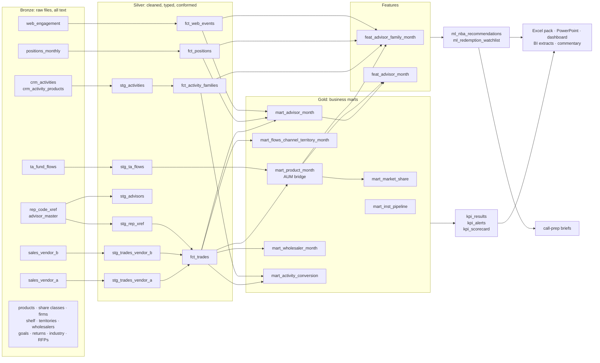

# Data lineage

Every table is built by a SQL file in [`models/`](../models). The runner discovers dependencies from the
`FROM` / `JOIN` clauses, so this picture is the same graph the code executes.

## Layers

| Layer | Rule | Tables |
| --- | --- | --- |
| Bronze | Exactly as received, every column text, plus `_source_file` / `_ingested_at` | 20 `raw_*` tables + `load_audit` |
| Silver | One row per real-world thing; types parsed; duplicates removed; keys mapped; nothing aggregated | 20 `stg_*` / `fct_*` tables |
| Gold | Business grain (fund-month, advisor-month, wholesaler-month...), the only layer reports read | 8 `mart_*` / `int_*` tables |
| Features | Model inputs with point-in-time windows; `y_*` / `t_*` columns look forward and are labels only | 2 `feat_*` tables |
| Serving | KPI results, alerts, call lists, watchlist, briefs, report files | `kpi_*`, `ml_*`, `ai_*`, `outputs/` |

## Keys that hold it together

* `rep_code` -> `advisor_key` through `stg_rep_xref`, **valid for the trade month** (advisors change codes when
  they move firms; split / joint codes missing from the crosswalk stay in as unmapped).
* `share_class_code` -> `product_code` (vendor B) and firm *name* -> `firm_id` (vendor B).
* `crm_contact_id` (CRM) and `email_hash` (marketing) -> `advisor_key`.
* `month_key` (yyyymm) everywhere, with `dim_month.month_index` for window arithmetic - no date functions,
  which is what keeps the SQL portable between SQLite and Spark.

## Controls along the way

Control totals at load (rows and dollars), uniqueness and mapping checks in silver, reconciliation to the
transfer agent in gold, and the column-documentation test on every table - see the
[data dictionary](data-dictionary.md) and `models/checks/`.
